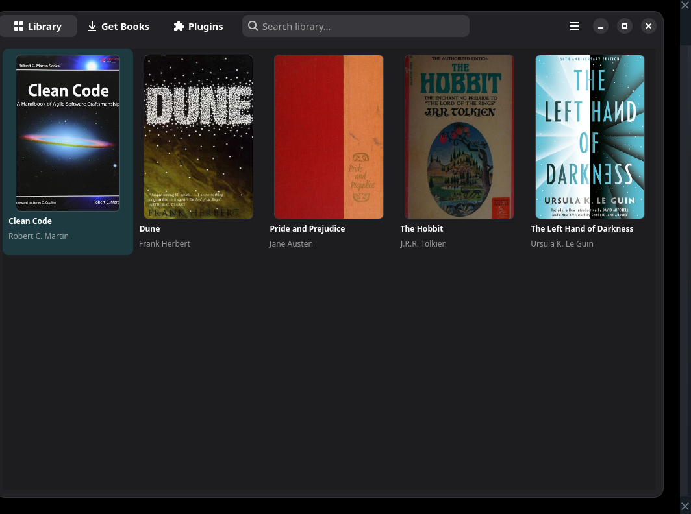
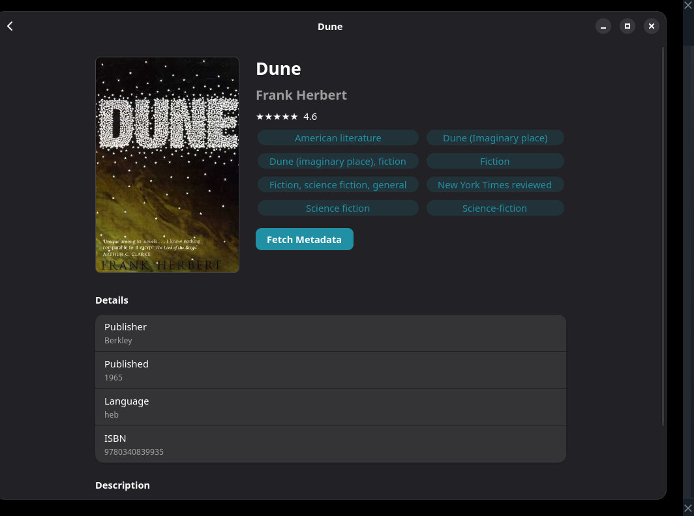
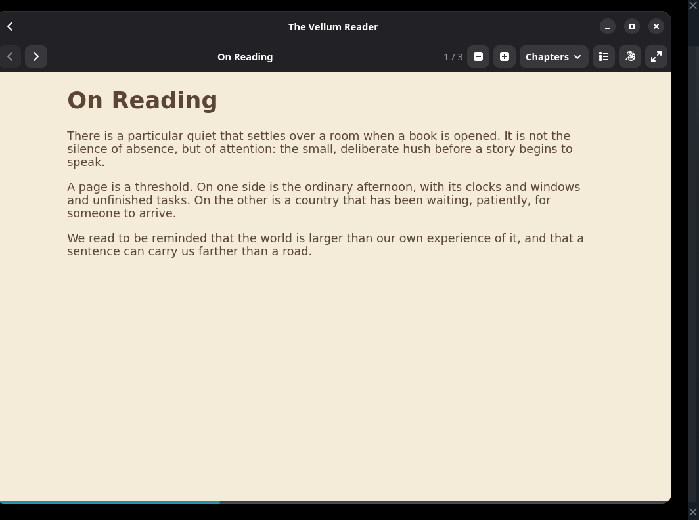
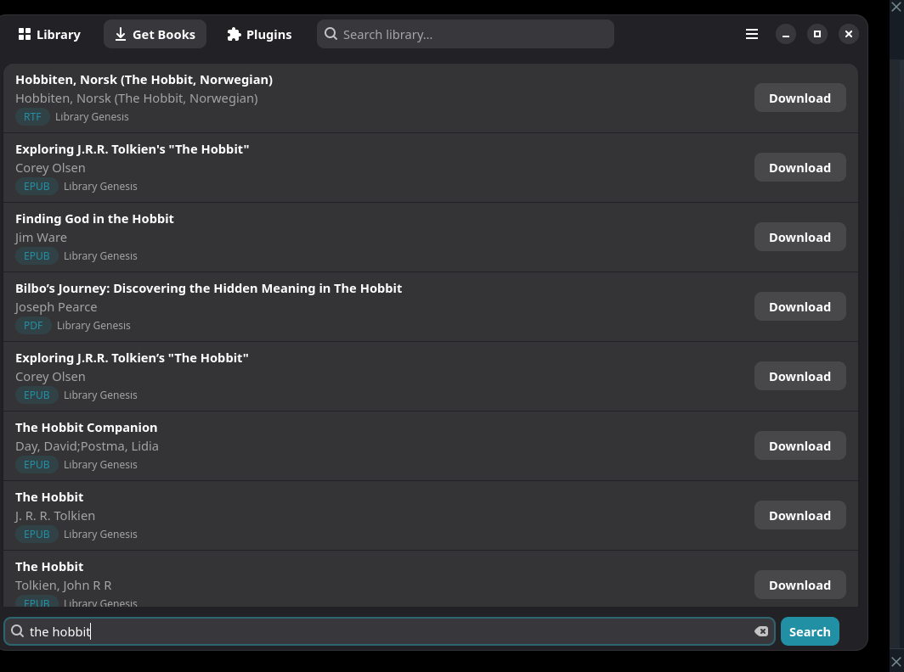
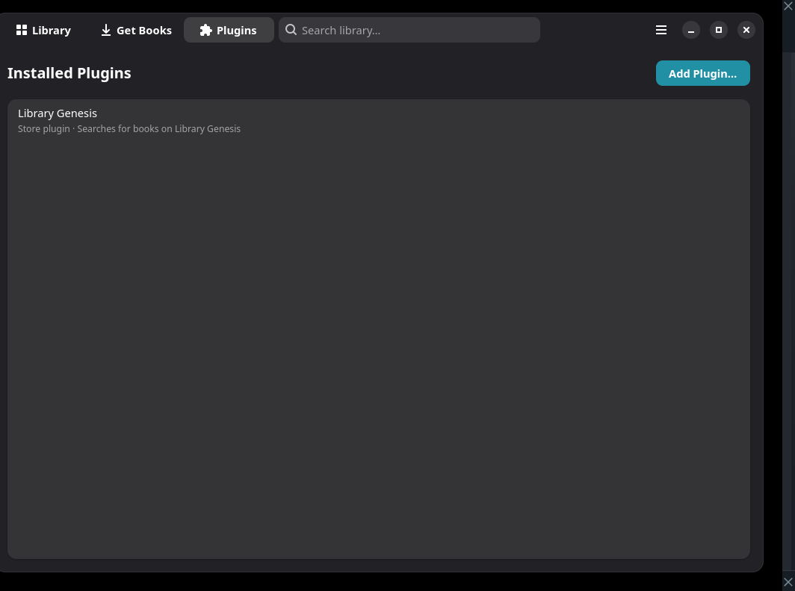

# Vellum

Vellum is a calibre-inspired ebook library manager with a modern
GTK4/Libadwaita interface. It organizes your ebook collection in a local
SQLite library, supports calibre metadata-source plugins out of the box,
and can look up book metadata (title, authors, covers, descriptions) from
online sources such as Google Books and OpenLibrary.

## Install

```sh
flatpak install --user https://puppycodingbadly.github.io/vellum/io.github.vellum.Vellum.flatpakref
flatpak run io.github.vellum.Vellum
```

Updates: `flatpak update io.github.vellum.Vellum`.



| Book details | Reader |
|---|---|
|  |  |

| Get Books | Plugins |
|---|---|
|  |  |

## Features

- Modern GTK4/Libadwaita user interface
- Library grid with exact 2:3 cover-poster tiles (title/author overlaid)
- SQLite-backed book library (authors, tags, formats, ratings, covers)
- Fast full-text-ish search across titles, authors, ISBNs, and tags
- Online metadata lookup from Google Books, Open Library, Internet
  Archive, Library of Congress, and Inventaire, restricted to English
  results, with cover previews and per-source merging
- Built-in reader for EPUB, PDF, and MOBI with a page-turn animation (toggleable in Preferences)
  - Text highlights (yellow/green/pink) with a highlights panel to review, jump to, and delete them (EPUB/MOBI only; PDF pages are image-rendered, so highlighting is not available there)
  - In-reader dictionary lookup for any selected word
  - Automatic reading-position resume per book
  - Chapter list (TOC) for quick navigation, adjustable font size, and Light/Sepia/Dark reader themes (or follow the app scheme)
  - Fullscreen reading (F11) and a bottom progress bar
- Switchable library directory from Preferences (calibre-style; the app
  reopens the library at the chosen folder)
- Import an existing calibre library folder (`metadata.db`), keeping books
  linked to the files already in that folder
- Universal metadata grabber: paste a book page URL and pull JSON-LD,
  OpenGraph, or microdata; optionally merge every source into one record
- Fuzzy metadata search from a free-form title/author/ISBN string
- Sort the library by title, author, rating, or recently added, and sort
  metadata results by relevance, title, author, rating, or newest
- Swipe left/right in the reader to turn pages/chapters
- Hide books from the library grid, with a "Show hidden books" toggle
- Compatibility with calibre metadata-source plugins (drop in the `.zip`)
- Import books from your Documents folder when running as a Flatpak

## Quick start (development)

Vellum needs PyGObject, GTK4/Libadwaita, WebKitGTK 6, Poppler's GI bindings,
and pycairo. Install them via your distro, e.g.:

- Fedora: `sudo dnf install python3-gobject gtk4 libadwaita webkitgtk6.0 poppler-glib python3-cairo`
- Debian/Ubuntu: `sudo apt install python3-gi gir1.2-gtk-4.0 gir1.2-adw-1 gir1.2-webkit-6.0 gir1.2-poppler-0.18 python3-cairo`

Without Poppler the rest of the app still runs, but PDF books show an
error instead of opening.

Then, from the repository root:

```sh
pip install -e .
python -m vellum.app
```

(`pip install -e .` installs the `src/`-layout package and the `vellum`
console script; `python -m vellum.app` runs the app entry point directly.)

## Flatpak

Build and install locally:

```sh
flatpak-builder --user --install --force-clean build flatpak/io.github.vellum.Vellum.yml
flatpak run io.github.vellum.Vellum
```

Or build with the Flathub Builder app without installing flatpak-builder:

```sh
flatpak run org.flatpak.Builder --user --install --force-clean build flatpak/io.github.vellum.Vellum.yml
flatpak run io.github.vellum.Vellum
```

The manifest targets the GNOME 49 runtime; it builds Poppler from source
because the GNOME runtime does not ship Poppler. Python dependencies are
vendored as wheels under `flatpak/wheels/`, so builds need no network.

### Install and update from the Vellum repository

The signed `v0.1.17` build is published at
`https://puppycodingbadly.github.io/vellum/`:

```sh
flatpak install --user https://puppycodingbadly.github.io/vellum/io.github.vellum.Vellum.flatpakref
flatpak update io.github.vellum.Vellum
```

The `.flatpakref` and `.flatpakrepo` files are also checked in at the
repository root.

## Crash reports

Vellum writes uncaught tracebacks, thread exceptions, and fatal-signal
stacks to
`~/.var/app/io.github.vellum.Vellum/data/vellum/crash.log` (Flatpak) or
`~/.local/share/vellum/crash.log` (source).

To collect the app log plus GNOME Shell/Mutter, sensor, and coredump
information in one file:

```sh
./scripts/collect-crash-report.sh
```

It writes `~/vellum-crash-report-<timestamp>.txt`.

## Plugins

Vellum can load calibre metadata-source plugins and store plugins. On the
**Plugins** page in the app, drop a calibre plugin `.zip`: metadata-source
plugins are registered as metadata sources, and store plugins appear under
**Get Books** immediately. Loaded metadata plugins can be removed from the
same page.

Calibre **GUI action plugins** (the Qt toolbar/dialog plugins) are not
supported, because Vellum is not a calibre GUI host. Store plugins and
metadata-source plugins are the supported extension points.

## Project layout

```
vellum/
├── data/                     # desktop entry + AppStream metainfo
├── flatpak/                  # Flatpak manifest
├── src/vellum/
│   ├── app.py                # application entry point (main)
│   ├── core/                 # Book/Author models, SQLite library
│   ├── metadata/             # metadata engine + online sources
│   │   └── sources/
│   ├── plugins/              # calibre plugin compatibility + manager
│   └── ui/                   # GTK4/Libadwaita user interface
└── tests/
```

## Roadmap

- OPDS / device sync support
- Ebook format conversion pipeline
- Full-text search over book contents
- Reading statistics and shelves/collections
- Publish on Flathub (with a proper app icon)
